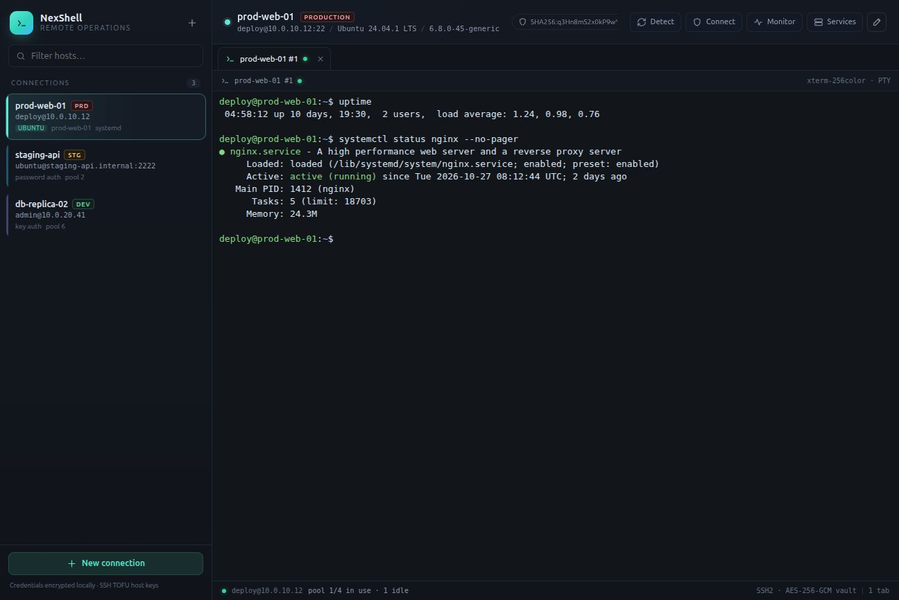
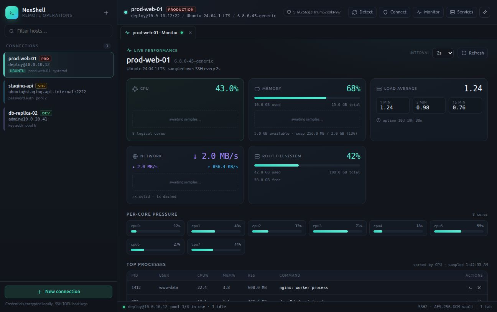
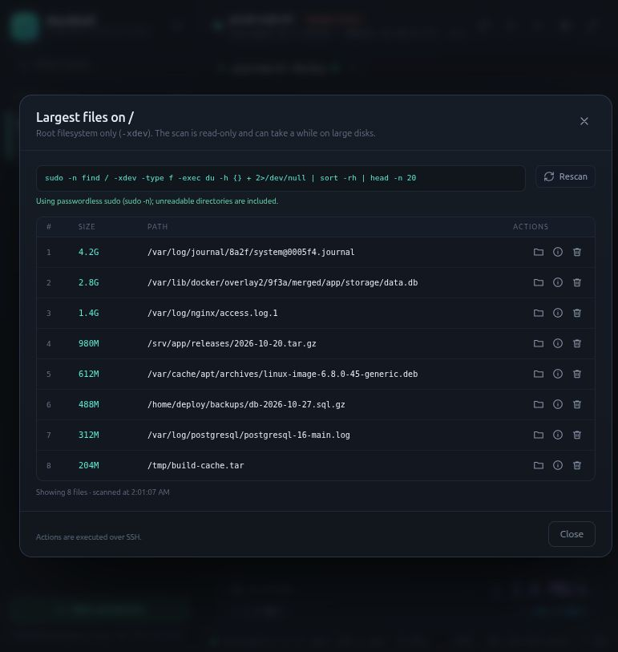
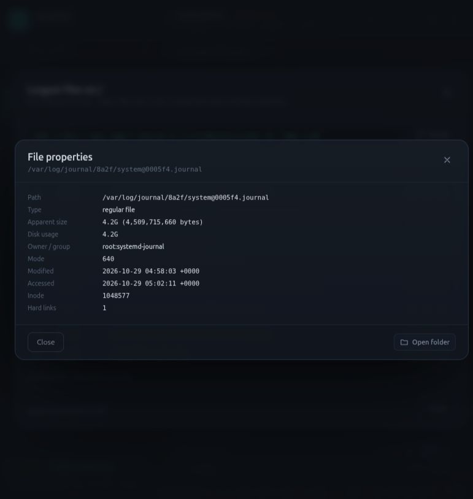
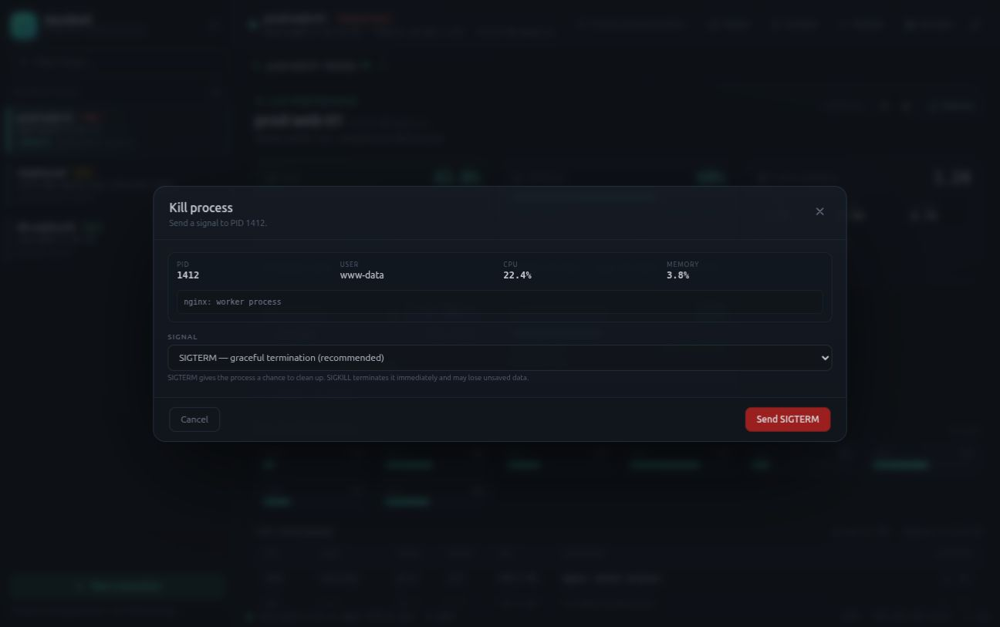
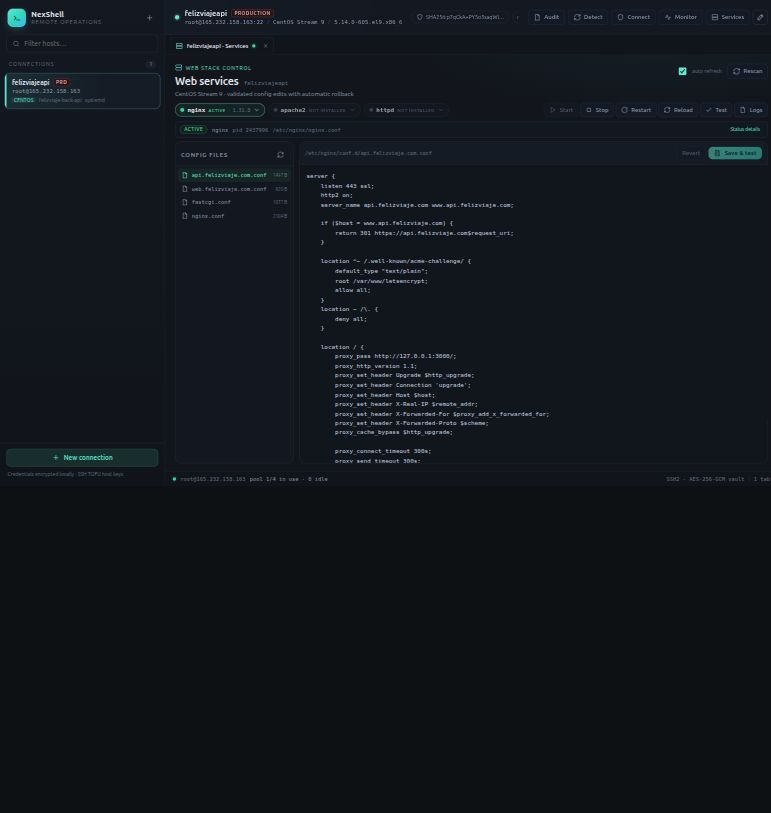
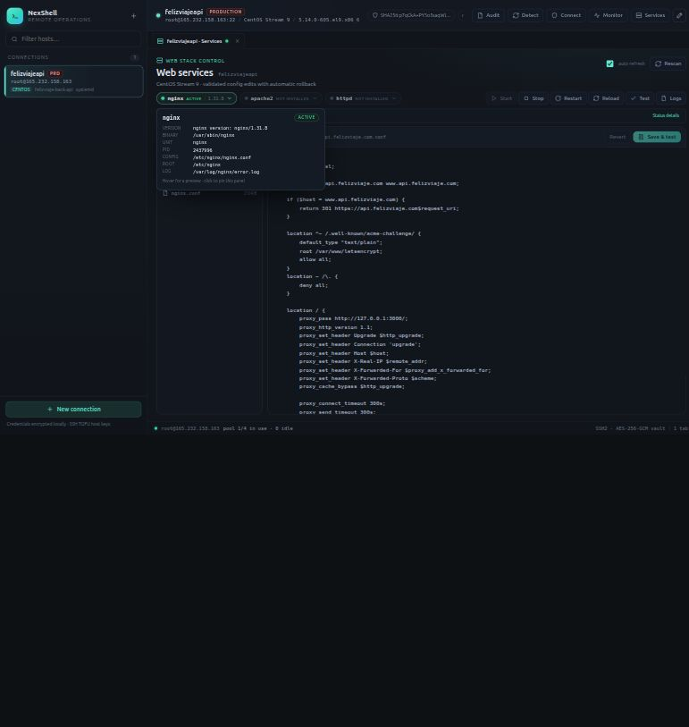
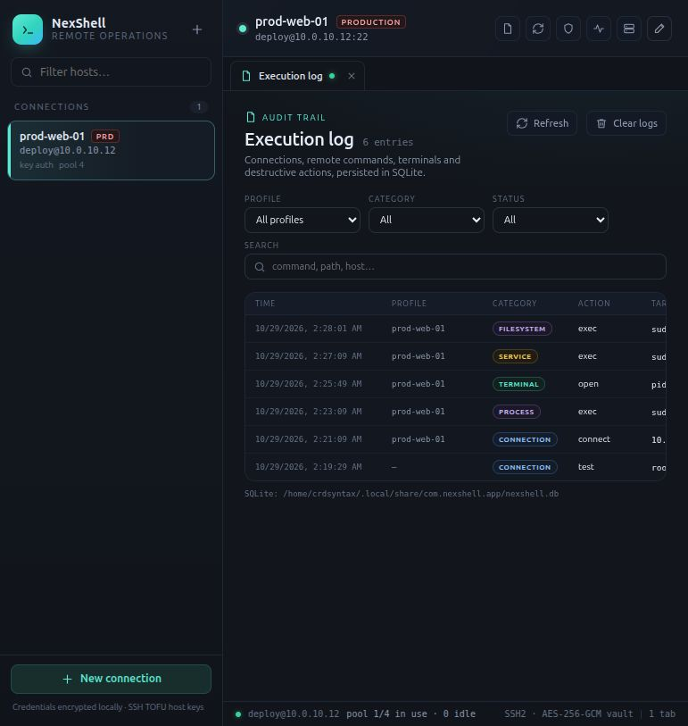
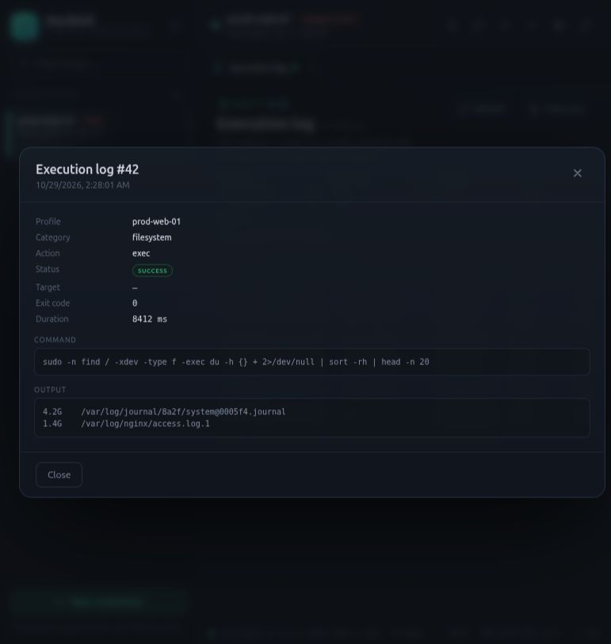
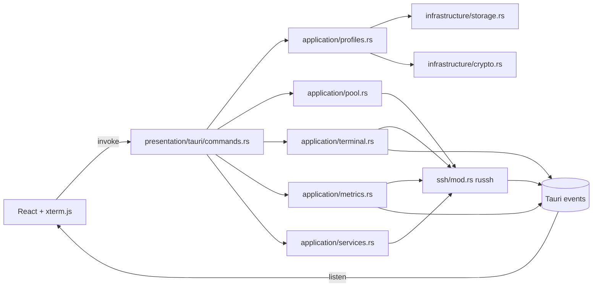

<p align="center">
  
</p>

# 2Shell

Consola de operaciones remotas multi-terminal construida con **Rust + Tauri 2 + React**.
Abre varias terminales SSH (PTY real) dentro de la aplicación, vigila el rendimiento del
host en tiempo real y administra **nginx**, **apache2** y **httpd** sin salir del escritorio.

> Prototipo funcional. La arquitectura sigue el modelo por capas:
> `presentation/tauri → application → infrastructure`, con `russh`, pooling explícito,
> eventos Tauri y estado React (zustand).



## Funcionalidades

- **Terminales SSH reales**: canal PTY (`xterm-256color`) con `russh`, redimensionado,
  scrollback y varias pestañas por host. xterm.js renderiza la salida en streaming.
- **Multi-terminal**: cada pestaña consume una conexión del pool del perfil; se pueden
  abrir terminales de distintos perfiles al mismo tiempo.
- **Perfiles de conexión**: contraseña o clave privada (ruta local elegida con el
  diálogo nativo de archivos o clave pegada), passphrase, color, entorno, tags y timeouts.
  Al elegir una clave cifrada se avisa y se enfoca el campo de passphrase.
- **Pool de conexiones** por perfil con tamaño máximo, timeout de adquisición, reciclado
  por inactividad y **reintentos con backoff exponencial + jitter**. Los fallos de
  autenticación o validación **no se reintentan** (evita bloqueos/fail2ban).
- **Detección del servidor**: SO, distro y familia, kernel, arquitectura, init system,
  gestor de paquetes, shell, CPU, RAM, contenedor, fingerprint SSH y servidores web
  instalados. Se muestra en la barra superior y en el test de conexión.
- **Monitor tipo htop**: CPU total y por núcleo, memoria/swap, load average, uptime,
  red (rx/tx), disco raíz y tabla de procesos, con muestreo configurable (1–10 s) y
  gráficas de historial. Cada proceso permite **abrir su directorio de trabajo en una
  terminal nueva** o **enviarle SIGTERM/SIGINT/SIGKILL** con confirmación. La tarjeta
  **Root filesystem** incluye un escaneo de los 20 archivos más grandes
  (`find / -xdev | du | sort -rh`), con acciones para abrir su carpeta, ver propiedades
  y eliminarlos.
- **Gestión de nginx / apache2 / httpd**: estado, start/stop/restart/reload, `configtest`,
  exploración y edición de configuración con **backup + validación + rollback automático**,
  y tail de logs.
- **Seguridad de credenciales**: AES-256-GCM en reposo, secretos nunca serializados hacia
  el frontend y verificación de host keys (TOFU).
- **Persistencia SQLite y auditoría**: perfiles, host keys y un log de ejecuciones
  (conexiones, comandos, terminales, servicios, procesos y archivos) con filtros,
  búsqueda, detalle y limpieza desde la pestaña **Audit**.

















## Arquitectura



| Capa | Responsabilidad |
| --- | --- |
| `presentation/tauri` | Comandos IPC, validación de entrada, mapeo a servicios |
| `application` | Perfiles, pool, terminales, métricas, servicios web |
| `infrastructure` | Persistencia SQLite (WAL) y cifrado AES-256-GCM |
| `ssh` | Handshake, autenticación, known hosts, exec, PTY/shell |
| `frontend` | UI React, xterm.js, zustand, servicios de IPC |

### Flujo de una terminal

1. `terminal_open(profileId, cols, rows)` adquiere un lease del pool.
2. `SshConnection::open_shell` abre un canal, solicita PTY y shell.
3. El canal se divide en `ChannelReadHalf` / `ChannelWriteHalf`.
4. El lector emite `terminal:data` con base64 (preserva UTF-8 entre paquetes).
5. El escritor consume un `mpsc` con datos, resize y close.
6. Al cerrarse el canal remoto se emite `terminal:closed` y se libera el lease.

### Pool y reintentos

- Máximo de transportes por perfil (`pool.maxConnections`).
- `acquire_timeout_ms` para esperar un transporte libre.
- `idle_timeout_secs` descarta transportes ociosos o cerrados.
- Cada intento de conexión usa `connect_timeout_secs`; los fallos se reintentan
  `max_retries` veces con backoff `base * 2^n`, limitado por `max_delay_ms` y jitter.
- El estado (`inUse`, `idle`, `total`) se muestra en la barra de estado.

## Estructura del proyecto

```text
nexshell/
├── frontend/
│   └── src/
│       ├── components/     # Sidebar, terminal, monitor, servicios, modal
│       ├── services/       # wrappers tipados de comandos Tauri
│       ├── store/          # zustand: perfiles, pestañas, métricas
│       ├── lib/            # IPC, bus de terminal, formato, acciones
│       └── types/
├── src-tauri/
│   └── src/
│       ├── presentation/tauri/commands.rs
│       ├── application/{profiles,pool,terminal,metrics,services}.rs
│       ├── infrastructure/{crypto,storage}.rs
│       ├── ssh/mod.rs
│       ├── models/mod.rs
│       └── state.rs
├── specs/remote-terminal/  # spec, design y tasks (SDD)
├── docs/
└── package.json
```

## Almacenamiento y auditoría

Linux:

```text
~/.local/share/com.nexshell.app/
├── nexshell.db          # SQLite (WAL): profiles, known_hosts, execution_logs
├── nexshell.db-wal
├── nexshell.db-shm
├── master.key           # clave AES-256-GCM, modo 0600
└── nexshell.json.migrated  # backup del almacén JSON anterior
```

- `profiles`: configuración completa del perfil en `config_json` y credenciales
  cifradas en `secret_blob`. Los secretos no se guardan en claro.
- `known_hosts`: fingerprint SSH por `host:port` (TOFU).
- `execution_logs`: timestamp, perfil, categoría, acción, objetivo, comando, estado,
  exit code, duración, salida y error. Retención: 10.000 entradas.
- Migración automática: al arrancar, si la base está vacía y existe `nexshell.json`,
  importa perfiles y host keys y renombra el JSON a `.migrated`.
- La base y sus sidecars `-wal`/`-shm` se fuerzan a modo `0600`.

> El identificador interno de la aplicación y la carpeta de datos siguen siendo
> `com.nexshell.app` / `nexshell.db` para no perder perfiles, host keys ni el log al
> rebrandear. La marca visible es **2Shell**.

El log **no** registra las pulsaciones dentro de una terminal (privacidad y volumen):
registra la apertura/cierre de sesiones y todos los comandos ejecutados por la app
(conexión, detección, servicios, procesos, archivos, `remote_exec`). Los sondeos de
métricas y de estado de servicios se excluyen para no inundar el log.

## Requisitos

- Linux (probado) con `webkit2gtk-4.1`, `gtk+-3.0` y dependencias de Tauri 2.
- Rust estable ≥ 1.77.
- [Bun](https://bun.sh) ≥ 1.1 (o npm/pnpm adaptando los scripts).
- Un host SSH accesible. Para gestionar servicios, sudo sin contraseña o permisos
  equivalentes.

## Arranque

```bash
# dependencias
bun install
cd frontend && bun install && cd ..

# desarrollo (levanta Vite + Tauri)
bun run dev
```

> Si aparece `tauri: command not found`, falta instalar las dependencias del
> proyecto raíz. Ejecuta `bun install` en `nexshell/` (no solo en `frontend/`).

Build de producción:

```bash
bun run build          # tauri build (deb/appimage)
# o solo el binario:
bun run frontend:build
cd src-tauri && cargo build --release
```

Comprobaciones:

```bash
cd frontend && bun run check && bun run build
cd src-tauri && cargo test --lib && cargo clippy --lib --all-targets -- -D warnings
```

## Uso

1. **Nueva conexión** → host, puerto, usuario y credenciales.
2. **Test connection** valida el handshake, detecta el servidor y muestra fingerprint,
   SO, kernel, CPU/RAM y servidores web.
3. **Terminal** abre una pestaña PTY. El botón `+` del host abre otra terminal.
4. **Monitor** inicia el muestreo (por defecto 2 s) y pinta CPU, memoria, red,
   disco y procesos.
5. **Services** detecta nginx/apache2/httpd. Permite operar el servicio y editar
   archivos `.conf`: guarda un backup, escribe, ejecuta el `configtest` y restaura
   si falla.

### Sudo para servicios

La opción *Use `sudo -n` for service actions* prefija **cada comando** con `sudo -n`
(no envuelve scripts completos), de modo que sudoers puede limitar binarios.
Ejemplo orientativo en `/etc/sudoers.d/twoshell`:

```sudoers
Cmnd_Alias TWOSHELL = /usr/bin/systemctl, /usr/sbin/service, \
  /usr/sbin/nginx, /usr/sbin/apache2ctl, /usr/sbin/httpd, \
  /usr/bin/cp, /usr/bin/find, /usr/bin/cat, /usr/bin/readlink, /usr/bin/tee, \
  /usr/bin/tail, /usr/bin/journalctl, /usr/bin/test, /usr/bin/base64, \
  /usr/bin/stat, /usr/bin/du, /usr/bin/rm, /usr/bin/kill

deploy ALL=(root) NOPASSWD: TWOSHELL
```

Si al abrir un archivo aparece **“permission denied”**, el usuario SSH no puede
leerlo (habitual en configuraciones propiedad de root con modo 600). Activa
*Use `sudo -n` for service actions* en el perfil y configura NOPASSWD para los
binarios de la whitelist, o ajusta los permisos del archivo en el servidor.
Si aparece **“sudo requires a password”**, falta NOPASSWD; la app no solicita ni
almacena la contraseña de sudo.

> Esta whitelist es amplia: `tee`/`cp` con argumentos arbitrarios permiten escribir
> archivos como root. Para producción, sustitúyela por un helper privilegiado que
> valide rutas y acciones, o por polkit.

## Comandos IPC

| Comando | Descripción |
| --- | --- |
| `list_profiles`, `save_profile`, `delete_profile` | CRUD de perfiles (secretos cifrados) |
| `test_profile` | Handshake + detección sin persistir |
| `connect_profile`, `disconnect_profile` | Abrir/cerrar un transporte del pool |
| `detect_server` | Inspección del host vía SSH |
| `pool_stats` | Estado del pool del perfil |
| `remote_exec` | Ejecución puntual de un comando |
| `terminal_open/write/resize/close/list` | Ciclo de vida de terminales |
| `terminal_open_process` | Nueva terminal en el `cwd` de un proceso |
| `process_locate` | `cwd`, ejecutable y comando de un PID |
| `process_kill` | Envía TERM, INT o KILL a un PID |
| `disk_large_files` | Top 20 de archivos grandes en `/` (`-xdev`) |
| `file_properties` | `stat`/`du` de un archivo |
| `file_delete` | Elimina un archivo con confirmación en la UI |
| `terminal_open_directory` | Nueva terminal en un directorio |
| `list_execution_logs` | Consulta el log con filtros y paginación |
| `clear_execution_logs` | Borra logs (global o de un perfil) |
| `audit_db_path` | Ruta de la base SQLite |
| `monitor_start/stop/snapshot` | Colector de métricas y última muestra |
| `service_detect/status/action` | Detección y control de servicios |
| `service_config_list/read/write` | Configuración con validación y rollback |
| `service_logs` | Tail de log o journalctl |

Eventos: `terminal:data`, `terminal:closed`, `metrics:update`, `metrics:error`.

## Pruebas

```bash
cd src-tauri && cargo test --lib
```

Cubren cifrado, persistencia sin secretos, parser de detección de servidor, parser
de `/proc` (CPU por deltas, memoria, red, procesos), backoff/jitter del pool y
confinamiento de rutas de configuración.

Para una prueba manual de extremo a extremo hay un host de demo con OpenSSH, nginx y
Apache (sin systemd, para probar el fallback a `service`):

```bash
docker build -f dev/Dockerfile.demo -t 2shell-demo .
docker run --rm -p 2222:22 --name 2shell-demo 2shell-demo
```

Conéctate a `127.0.0.1:2222` con `deploy/deploy` (marca *elevated*). Instrucciones en
[`docs/demo.md`](docs/demo.md).

## Limitaciones del prototipo

- La clave maestra AES se guarda en `app_data_dir/master.key` (0600). En producción
  debe vivir en el keyring del SO o Tauri Stronghold.
- El log de auditoría guarda comandos y salidas; puede contener rutas o datos
  sensibles. Usa la pestaña Audit para revisarlo o limpiarlo.
- Host keys por TOFU: la primera conexión confía; una discrepancia posterior se rechaza
  sin diálogo de aceptación.
- Solo autenticación por contraseña o clave; no keyboard-interactive/2FA, agent
  forwarding ni SFTP.
- Las métricas asumen Linux (`/proc`, `ps`, `df`). No hay soporte BSD/macOS/Windows.
- `service_config_list` usa `find -printf` (GNU find); en BusyBox puede devolver vacío.
- Los symlinks de `sites-enabled` se validan con `readlink -f`; un destino fuera del
  `configRoot` se rechaza.
- Las rutas de configuración son las de distros Debian/RHEL; nginx en rutas no estándar
  requiere ampliar `ServiceSpec`.
- No hay persistencia de pestañas ni reconexión automática infinita: la terminal ofrece
  un botón *Reconnect* y el backend reintenta la conexión inicial.
- No se almacenan logs de auditoría de comandos en esta versión.

## Roadmap

- Keyring del SO y firma de actualizaciones.
- Agent forwarding, SFTP y túneles locales/remotos.
- Soporte de `systemd` units arbitrarias y Caddy.
- Historial de comandos y auditoría firmada.
- Tests de integración contra un servidor SSH embebido.
